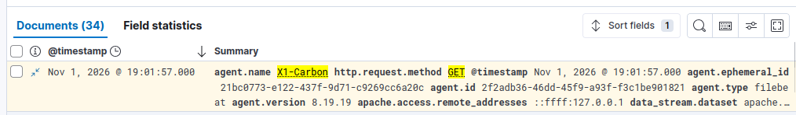
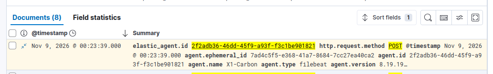
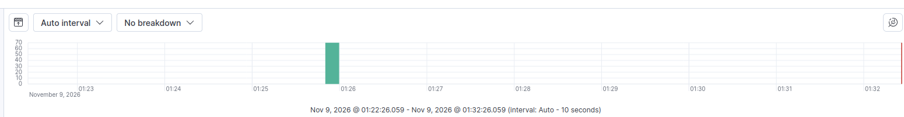

# Homelab Entry #6: Improving Endpoint Visibility (WIP)

Although Elastic *technically* works, there is still much work to be done. Sysmon isn't configured correctly, and there are lots of visibility gaps. Therefore, I will try to identify log sources and information that I will need to detect relevant attacks on my Juice Shop endpoint.

To avoid high complexity dealing with privacy and data laws, they will not be considered here. First, I'll create a table with ATT&CK techniques I want to focus on and the data sources needed for them. For simplicity's sake, I will only choose one technique per tactic.

| ATT&CK Technique | Description | Sources Needed |
|------------------|-------------|----------------|
| T1190 | Initial Access: Exploit Public-Facing Application | Webserver Access Logs (Visibility Gap: POST bodies not visible) |
| T1059 | Execution: Command and Scripting Interpreter | Sysmon (EventID 1), Powershell Operational Log (EventID 4104) |
| T1112 | Persistence: Modify Registry | Sysmon (EventID 12,13,14) |
| T1078 | Privilege Escalation: Valid Accounts | Windows Security Logs (EventID 4624, 4625) |
| T1685.005 | Defense Impairment: Clear Windows Event Logs | Windows Security Logs (EventID 1102), Windows System Logs (EventID 104) |
| T1003.001 | Credential Access: OS Credential Dumping - LSASS Memory | Sysmon (EventID 10) |
| T1082 | Discovery: System Information Discovery | Sysmon (EventID 1) |
| T1560 | Collection: Archive Collected Data | Sysmon (EventID 1) |
| T1105 | C2: Ingress Tool Transfer | Sysmon (EventID 3, 11), Network Logs |
| T1048 | Exfiltration: Exfiltration over Alternative Protocol - Exfiltration over Unencrypted Non-C2 protocol (HTTP) | Network Logs, Sysmon (EventID 3) |
| T1485 | Impact: Data Destruction | Sysmon (EventID 1, 9, 23, 26, 28) |

## T1190 || Initial Access: Exploit Public-Facing Application 
### Overview <!-- Goals and Necessary Data Sources -->
The SIEM currently has zero visibility on the Juice Shop, posing a significant risk as responding to incidents and detecting attackers will be heavily delayed and hindered without proper visibility. The most immediate action is to ingest the Juice Shop's access logs into the SIEM.

### Current Visibility
**Missing.** I do not have visiblity in webserver logs. After clicking around on the Juice Shop, a broad search for GET requests produces no results.

### Configuration Changes
I install the Elastic Apache integration and aim it towards the relevant Juice Shop access logs.

### Simulation
GET requests seem to now get logged. Awesome. This shows us that the events are coming in normally.

Lets see if it can also catch a POST request. I send a login request, and the respective event appears as expected. However, I note a gap in visiblity—the contents of the POST request are not logged.

Now, lets test some common attacks against the Juice Shop. First, I'll test a simple (successful) brute force attack against the login page of the webserver using ffuf with the Attacker VM. Looking back at Elastic SIEM, I immediately see a massive spike in the amount of logs.

Now, lets see if I have sufficient data to triage this attack if it were a real one. Looking through the timeframe from Nov 9, 2026 @ 01:25:50 to Nov 9, 2026 @ 01:26:00 in the logs, I observe:
- the most common IP address, seen in the source.ip field with 70 records, is `10.0.0.22`. This is the auto-assigned IP address for my Attacker VM.
- the targeted URL, seen in the url.path field, was `/rest/user/login`. The URL aligns with the brute force attack.
- the brute force is fast—the 70 requests were generated within the span of 10 seconds, so approximately 7 requests a second.
- the tool used was FFUF, seen in the user_agent.original field as `Fuzz Faster U Fool v2.1.0-dev`.
- the attacker was successful, as the attacker had a successful sign-in, seen through an HTTP response code 200 (success).

The main information of a brute force attack is collectible, and thus the visibility is acceptable against brute force attacks.

### Findings

The visibility of the Juice Shop has been significantly improved with the ingestions of access logs into the SIEM. It provides important surface-level data for most operations. However, access logs are insufficient for determining POST request bodies, and without a reverse proxy or another solution, a login bypass via SQL injection may look the same as a regular login.